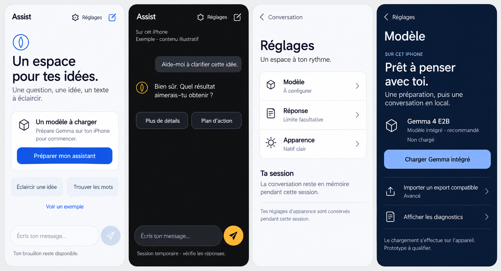

# Assist — affinage depuis la référence partagée

La [conversation publique fournie](https://chatgpt.com/share/6ad28adf-17ac-83ea-9a49-96977bd06dec) précise la direction retenue : **cercle, graine, proportion et rythme**. Cette révision traduit cette référence dans l’interface React Native existante, avec les trois apparences Natif clair, Graphite et Bleu profond.

## Référence finale

Cette image de 1702 × 924 px est la **dernière planche corrigée** du partage. Le symbole possède un cercle fin entièrement fermé et une graine verticale, symétrique et séparée de son contour. Le même signe accompagne la réponse de l’assistant. Les versions précédentes conservaient une silhouette pleine proche d’un « Q » ; cette silhouette a été explicitement rejetée dans la conversation. La miniature publique du partage montre encore une de ces versions antérieures : elle ne constitue pas la cible de cette révision.

La planche est une référence de conception produite par génération d’image. Elle ne prouve ni l’état du moteur, ni le chargement d’un modèle, ni le comportement de l’app sur iPhone.

## Système appliqué

- **Identité.** Le cercle et la graine remplacent le précédent signe. Le diamètre du signe est de 48 pt à l’accueil et de 28 pt dans les réponses. La graine est construite par deux courbes symétriques ; son axe reste vertical et son contour ne touche pas le cercle extérieur. Le rapport entre le diamètre extérieur et la hauteur géométrique de la graine vaut φ = (1 + √5) / 2, soit environ 1,618. Cette proportion porte sur la construction, pas sur une amélioration d’utilisabilité démontrée.
- **Composition.** L’identité, les titres et les contenus partagent un axe à gauche. Les marges communes restent de 24 pt. Les espacements de 8, 13, 21 et 34 pt donnent un rythme aux groupes sans imposer une formule aux textes ni aux cibles tactiles. Aucun motif de construction géométrique n’est affiché derrière l’accueil ou les messages.
- **Typographie.** Les titres principaux adoptent une graisse moyenne et une échelle de 34/42 pt. Le texte courant conserve 16/24 pt. Les trois valeurs secondaires des réglages partagent 14/20 pt. Les phrases peuvent se répartir sur plusieurs lignes ; le texte ne rétrécit pas pour reproduire une maquette.
- **Conversation.** L’accueil conserve une préparation explicite, deux amorces modifiables et un exemple étiqueté. La réponse de l’assistant reste du texte ouvert, accompagné du signe. La bulle utilisateur Graphite est neutre ; l’ambre sert aux accents fonctionnels. La saisie garde sa position et sa géométrie communes entre l’accueil et la conversation.
- **Réglages.** Le titre « Réglages » appartient au contenu de la page. Trois lignes présentent leur valeur sous leur libellé, avec des icônes plates et des séparateurs communs. La note sur les préférences temporaires est séparée de l’explication de la session. Le champ de limite de réponse, ses erreurs et le retour du focus sur Apparence restent disponibles.
- **Modèle.** L’identité et l’état du modèle sont intégrés à la page, sans carte extérieure. La préparation constitue la première action. L’import et les diagnostics utilisent des lignes ouvertes avec des icônes et des axes de texte alignés. L’import reste repliable ; ses exigences, les gardes natives, les actions de chargement, de déchargement et de partage sont conservées. Le rapport garde son avertissement sur le contenu généré.

Ces choix appliquent les règles d’[Infographic Artist](plugin://app-6a695eda913881919ef52582023f0ca2@openai-curated-remote/) de hiérarchie, de réduction, de couleur fonctionnelle et de grammaire commune. Ils sont aussi des adaptations au contenu réel d’Assist ; la proportion φ n’est pas une garantie d’intuition ou de perfection.

## Différences nécessaires avec la planche

L’aperçu navigateur indique réellement **« Moteur iOS indisponible »** et désactive les actions qui nécessitent le moteur. Il n’affiche pas un envoi actif uniquement pour ressembler à l’image. Le nom et l’état du modèle, sa disponibilité intégrée, ses mesures et ses rapports proviennent de l’état disponible ; une disponibilité inconnue reste inconnue.

Le titre **« Préparer l’assistant »** décrit l’action à accomplir. Il remplace la promesse visuelle « Prêt à penser avec toi » lorsque cette disponibilité n’est pas établie. La configuration avancée et les rapports existants restent accessibles, même s’ils n’apparaissent pas dans la planche. La conversation illustrative reste séparée de l’historique réel, des requêtes d’inférence et des rapports partagés.

L’ancien audit **8,4/10 était provisoire et précède cette révision**. Aucune nouvelle note UX n’est attribuée ici.

## Captures de cette révision

Ces captures montrent le même code dans le navigateur, à 390 × 844 px. Les cinq vues ont aussi été contrôlées à 320 px dans les trois apparences : aucun débordement horizontal ni contrôle coupé horizontalement dans les 30 combinaisons observées. Les pages longues restent défilantes. Ces captures ne remplacent pas une validation native.

| Vue                       | Natif clair                                              | Graphite                                                    | Bleu profond                                            |
| ------------------------- | -------------------------------------------------------- | ----------------------------------------------------------- | ------------------------------------------------------- |
| Accueil                   | [Capture](shared-reference/entity-home-light.png)        | [Capture](shared-reference/entity-home-graphite.png)        | [Capture](shared-reference/entity-home-blue.png)        |
| Conversation illustrative | [Capture](shared-reference/entity-chat-light.png)        | [Capture](shared-reference/entity-chat-graphite.png)        | [Capture](shared-reference/entity-chat-blue.png)        |
| Réglages                  | [Capture](shared-reference/entity-settings-light.png)    | [Capture](shared-reference/entity-settings-graphite.png)    | [Capture](shared-reference/entity-settings-blue.png)    |
| Modèle                    | [Capture](shared-reference/entity-model-light.png)       | [Capture](shared-reference/entity-model-graphite.png)       | [Capture](shared-reference/entity-model-blue.png)       |
| Diagnostics               | [Capture](shared-reference/entity-diagnostics-light.png) | [Capture](shared-reference/entity-diagnostics-graphite.png) | [Capture](shared-reference/entity-diagnostics-blue.png) |

La révision UI a passé `npm run check` avec **259 tests dans 13 suites**, TypeScript, ESLint et génération des interfaces iOS. Des ajouts vocaux ont ensuite modifié l’état partagé en parallèle ; ils ont été conservés. Sur le dernier état contrôlé, les **30 tests de parcours UI** repassent, ainsi que TypeScript, ESLint, la compilation web et le bundle JavaScript Metro iOS. Le dernier contrôle global compte **273 tests réussis et 5 échecs dans la nouvelle suite `VoiceApp.test.tsx`** ; il n’est donc pas entièrement vert. La génération iOS de ce dernier contrôle n’a pas été atteinte après l’échec des tests.

Le navigateur confirme la conservation du brouillon et de la limite de réponse entre les écrans, les commandes natives désactivées sans moteur, la sélection clavier des thèmes, Échap et le retour du focus sur Apparence. Aucune erreur de page ou de console n’a été observée pendant ce parcours. Une nouvelle ouverture après les ajouts vocaux confirme le maintien du rendu accueil/réglages/modèle et l’absence des commandes vocales sans module natif.

Le [registre de vérification](verification.json) associe ces résultats aux empreintes des sources contrôlées et signale les modifications vocales qui ont continué ensuite. La compilation native, les zones de sécurité, le clavier, VoiceOver et l’inférence sur iPhone restent à vérifier dans l’environnement Apple.
