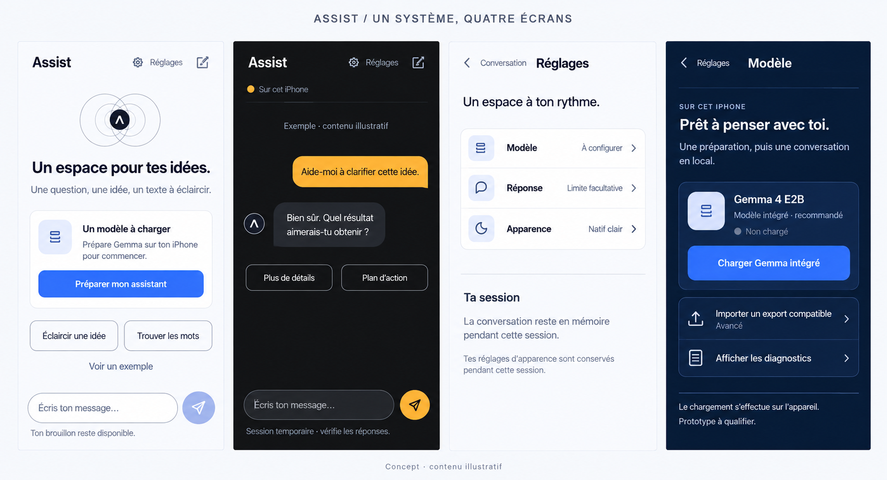

# Assist — une interface pensée comme un ensemble

> **Itération précédente.** Ce document conserve les choix, captures et vérifications de la première refonte d’ensemble. La [révision depuis la référence partagée](shared-reference-refinement.md) décrit la direction actuelle ; les résultats ci-dessous ne valident pas ses nouvelles sources.

La conversation est l’espace principal. Un modèle absent conduit à une préparation explicite ; les préférences partagent un seul accès **Réglages**. La préparation avancée et les diagnostics restent accessibles sans occuper le premier écran.

## Direction visuelle

Planche produite avec **Imagegen intégré**, à partir des captures réelles de l’app. Le [prompt exact](whole-system-imagegen-prompt.md) conserve les trois apparences choisies et décrit un système unique. Cette image est une direction de conception, pas une capture d’exécution native.

L’implémentation conserve les palettes existantes et les états réels. Dans le navigateur, le moteur iOS demeure indisponible, les commandes natives sont désactivées et le bouton d’envoi est neutre. La bulle utilisateur Graphite reste grise ; l’ambre sert aux actions actives. Le titre du modèle décrit la préparation plutôt qu’une disponibilité non établie.

## Revue du parcours initial

Les captures ont été prises et inspectées pendant cette refonte : [conversation](whole-system/entity-before-conversation.png), [modèle](whole-system/entity-before-model.png), [diagnostics](whole-system/entity-before-diagnostics.png), [apparence](whole-system/entity-before-appearance.png).

1. **Conversation — entrée dispersée.** Le statut du modèle, Apparence et Options créaient trois points de réglage séparés. Le champ acceptait un brouillon, mais l’envoi désactivé n’était accompagné que d’une petite consigne en bas.
2. **Modèle — préparation peu hiérarchisée.** Les commandes d’intégration, d’import, de chargement et de déchargement formaient une longue pile. Les exigences d’un export compatible étaient peu visibles.
3. **Diagnostics — densité élevée.** Les introductions et les panneaux techniques se succédaient sans sélection préalable de la tâche. Une fermeture de panneau introduite pendant la refonte aurait pu effacer son résultat détaillé ; ce risque a été corrigé avant livraison.
4. **Apparence — contrôle fonctionnel isolé.** Les trois choix et leur navigation clavier fonctionnaient, mais ce panneau n’appartenait pas à un espace de préférences commun.

Ces observations portent sur l’interface et ses interactions accessibles dans le navigateur. Elles ne constituent pas un test humain d’utilisabilité ni une validation VoiceOver sur iPhone.

## Parcours réalisé et vérifié

| Étape | Comportement | État de vérification |
| --- | --- | --- |
| 1. Accueil | Une préparation contextualisée explique le modèle manquant et propose **Préparer mon assistant**. Le brouillon reste éditable. | Rendu et navigation vérifiés ; moteur natif absent dans l’aperçu. |
| 2. Conversation | Même en-tête, même saisie ; un échange illustratif est explicitement étiqueté. Les mesures de génération sont placées dans **Détails de la réponse**. | Exemple et amorces vérifiés ; génération, annulation et historique contrôlés avec les fixtures de protocole. |
| 3. Réglages | Modèle, réponse et apparence sont regroupés. Une limite invalide possède un lien de correction depuis la conversation. La portée temporaire de la session est visible. | Aller-retour, conservation du brouillon et de la limite, erreurs et clavier du sélecteur vérifiés. |
| 4. Modèle | Le modèle intégré constitue le parcours principal. **Importer un modèle** révèle les exigences et les deux étapes d’import. Les retours respectent l’écran d’origine. | Navigation et gardes de disponibilité vérifiées ; chargement physique non vérifié. |
| 5. Diagnostics | Les tâches s’ouvrent à la demande. Les panneaux initialisés conservent leurs rapports ; le suivi se suspend quand l’écran n’est plus actif. Un contrôle en cours bloque la sortie de cet écran. | Initialisation différée et conservation des rapports contrôlées. Les résultats restaurés sans lien établi au dossier sélectionné sont marqués comme historiques. |

Les cinq vues ont été contrôlées en **Natif clair**, **Graphite** et **Bleu profond**, à **320 et 390 px** : aucun débordement horizontal ou contrôle coupé dans ces 30 combinaisons. La navigation radio, Échap et le retour du focus sur Apparence passent dans le navigateur.

### Captures de l’app réelle

| Vue | Natif clair | Graphite | Bleu profond |
| --- | --- | --- | --- |
| Accueil | [Capture](whole-system/entity-home-light.png) | [Capture](whole-system/entity-home-graphite.png) | [Capture](whole-system/entity-home-blue.png) |
| Conversation illustrative | [Capture](whole-system/entity-chat-light.png) | [Capture](whole-system/entity-chat-graphite.png) | [Capture](whole-system/entity-chat-blue.png) |
| Réglages | [Capture](whole-system/entity-settings-light.png) | [Capture](whole-system/entity-settings-graphite.png) | [Capture](whole-system/entity-settings-blue.png) |
| Modèle | [Capture](whole-system/entity-model-light.png) | [Capture](whole-system/entity-model-graphite.png) | [Capture](whole-system/entity-model-blue.png) |
| Diagnostics | [Capture](whole-system/entity-diagnostics-light.png) | [Capture](whole-system/entity-diagnostics-graphite.png) | [Capture](whole-system/entity-diagnostics-blue.png) |

## Système commun et preuves

Les écrans utilisent les mêmes composants de titre, groupe, ligne de réglage, action et divulgation progressive. Les marges de 24 pt, les cibles d’au moins 44 pt, les actions de 52 pt et l’échelle typographique sont partagées. Le sceau géométrique et son rythme de Fibonacci restent une signature de l’accueil ; le motif ne passe pas derrière les messages.

`npm run check` passe **259 tests dans 13 suites**, TypeScript, ESLint et la génération des interfaces iOS. La compilation web et le bundle JavaScript Metro iOS passent également. Un test de régression vérifie notamment que les 48 sorties d’une qualification simulée restent dans le rapport partagé après fermeture puis réouverture du panneau, même si le marqueur natif sauvegardé est plus petit. Il s’agit de fixtures, pas de résultats obtenus sur appareil.

Le [registre de vérification](verification.json) contient les empreintes des sources, les résultats des parcours et les limites de preuve. Les 57 paires de couleurs précédemment calculées restent applicables aux mêmes jetons inchangés ; elles ne couvrent pas tous les états et n’établissent pas une conformité WCAG globale.

La compilation native, le clavier et les zones de sécurité sur iPhone, VoiceOver et l’inférence réelle restent à valider sur l’environnement Apple. Aucune nouvelle note UX n’est attribuée.
